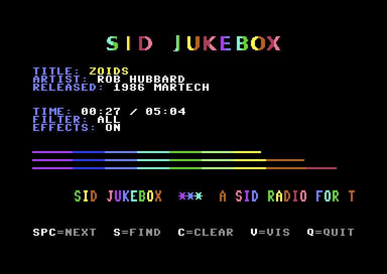

# SID Jukebox pour C64 Ultimate

🇫🇷 Français · [🇬🇧 English](README.md)

Un jukebox en ligne façon *Belote LAN C64* : le **C64 Ultimate** demande un morceau SID au hasard à un
serveur, le reçoit par le réseau de l'Ultimate (UCI/TCP) et le **joue lui-même** (le 6510 exécute le code
du morceau, comme à l'époque). Pas de synchronisation entre les clients : chacun a son tirage.

🌐 **Page web : <https://sidbox.boombass.net>**

L'écran de lecture : logo géant, titre / artiste / année, temps écoulé, trois vu-mètres (un par voix du
SID, en dégradé arc-en-ciel), scroller de démo dont le texte vient du serveur, touches.



*L'écran de lecture, capturé dans l'émulateur VICE (version démo) : titre arc-en-ciel, vu-mètres, scroller piloté par le serveur, version dans le coin.*

```
 ┌────────────┐   texte, TCP :6474    ┌──────────────────────┐
 │  serveur   │ ◄───────────────────► │  C64 Ultimate        │
 │ server.py  │   RANDOM3 [motif]     │  c64/ (assembleur)   │
 │ jukebox.db │ ──► OK3|…|code+relais │  UCI : sockets TCP   │
 └─────┬──────┘                       └──────────────────────┘
       │ indexer.py, sidscan (émulation)
 ┌─────┴──────┐
 │ HVSC (SID) │   ~61 000 fichiers, durées : Songlengths.md5
 └────────────┘
```

## Démarrage rapide

Prérequis : Python 3, un compilateur C (`cc`, pour `sidscan`), `7z`, **Java** et **Kick Assembler** 5.25 (`make KICKASS=/chemin/KickAss.jar`, par défaut `~/KickAssembler/KickAss.jar`), les ROM KERNAL et BASIC du C64 de VICE (pour `sidscan` ; `c64/chargen_set1.bin` seulement pour regénérer le titre, voir `c64/tools/dump_chargen.py`), un C64 Ultimate
avec l'API REST et la *Command Interface* activées. VICE est facultatif (tests sans matériel).

```sh
# 1. la HVSC (à télécharger sur https://hvsc.c64.org/) puis l'index des morceaux jouables
python3 indexer.py /chemin/vers/C64Music -o jukebox.db --max-addr 0xAEFF
# 1b. l'analyse v2.0 (émule chaque morceau, quelques minutes) : morceaux jouables, écritures dans le SID
cc -O2 -o sidscan sidscan.c && python3 scan_db.py --root /chemin/vers/C64Music

# 2. le serveur (port 6474)
python3 server.py --root /chemin/vers/C64Music

# 3. le client C64 (SERVER, PORT et ULTIMATE en ligne de commande ou dans c64/Makefile)
cd c64
make SERVER=boombass.net PORT=6474 ULTIMATE=192.168.1.27 deploy
```

`--max-addr` doit rester égal à `HISTART - 1` (`c64/src/memmap.asm`), comme `SCAN_HISTART` de `server.py` et les valeurs par défaut de
`scan_db.py` et `update_db.sh` ; `test_v3.py` le vérifie. C'est la limite haute des morceaux, le client occupe la mémoire au-dessus.

## Mettre le serveur en ligne

```sh
python3 server.py --root /chemin/vers/C64Music --port 6474      # 0.0.0.0 par défaut
```

- Ouvrir le port TCP dans le pare-feu (`firewall-cmd --add-port=6474/tcp --permanent`) et chez l'hébergeur.
- Sans accès root, un service `systemd --user` convient (`~/.config/systemd/user/jukebox.service`,
  `Restart=on-failure`) ; pour qu'il survive à la fermeture de session et au redémarrage, un administrateur
  doit lancer `sudo loginctl enable-linger <compte>`.
- Mettre à jour la base des morceaux après une nouvelle HVSC : [docs/UPDATE_DB.fr.md](docs/UPDATE_DB.fr.md).
- Publier une nouvelle version du client : [docs/RELEASE.fr.md](docs/RELEASE.fr.md).
- Mise à jour depuis GitHub : `git pull` dans le dossier du serveur (clé de déploiement en lecture seule
  si le dépôt est privé), puis redémarrer le serveur.

## Texte du scroller

Le texte vient du fichier **`scroll.txt`** à côté de `server.py` (option `--scroll`). Il est relu à chaque
requête : on le modifie sans redémarrer, et le nouveau texte arrive **au morceau suivant** (le C64 ne
contacte pas le serveur pendant la lecture).

- Alphabet : `A-Z 0-9 * . , ! ? - / ' :` (45 glyphes) ; minuscules mises en majuscules, accents retirés, le reste
  devient un espace.
- 150 caractères au plus ; le serveur ajoute 10 espaces avant et après.
- Fichier absent ou vide : le C64 affiche son court texte intégré.

## Touches

| Touche | Effet |
|---|---|
| `SPACE` | morceau suivant |
| `S` | recherche par artiste ou titre : les morceaux suivants sont tirés au hasard parmi les résultats (RETURN valide, RUN/STOP annule, RETURN seul = tout, donc efface la recherche ; rien trouvé : `NO MATCH` puis un morceau au hasard) |
| `L` | boucle on/off : rejoue le même morceau à la fin (le morceau repart quand on la change) |
| `V` | vu-mètres on/off (rejoue le même morceau depuis 0:00) |
| `Q` | quitte (retour au BASIC) |

## Le protocole (texte, une commande par ligne)

```
RANDOM [motif]  ->  OK|id|taille|secondes|images/s|sous-morceau|chargement|init|play|titre|auteur|année|scroller\n
                    + <taille> octets de code brut (sans en-tête PSID)
RANDOM2 <fin> [motif]  ->  idem ; <fin> = dernière adresse laissée aux morceaux par le client (HISTART - 1), 4 chiffres
                    hexadécimaux, ex. AEFF : seuls les morceaux qui finissent au plus tard à cette adresse sont
                    proposés (client v1.5+)
GET <id>        ->  idem pour un morceau précis
RANDOM3 <fin> [motif]  ->  OK3|id|taille|secondes|images/s|sous-morceau|chargement|init|play|relais|taille_relais|complet|titre|auteur|année|scroller\n
                    + <taille> octets de code (sites d'écriture SID remplacés par JSR vers les relais) + <taille_relais>
                    octets de bloc de relais, à copier à <relais> (client v2.0)
GET3 <id>       ->  idem pour un morceau précis
STATS           ->  STATS|compatibles|total
erreur          ->  ERR|message
```

Les clients v1.x ne reçoivent jamais de morceau modifié, ni les morceaux que l'analyse juge dangereux pour leur lecteur
(`v1_risque`, 683 morceaux). La spécification complète de la v2.0 est [SPEC-v2.md](SPEC-v2.md). Les clients antérieurs à la v1.5 envoient `RANDOM` simple : le serveur ne leur propose alors que des morceaux finissant avant `$A700`. Un client v1.5+ face à un serveur sans `RANDOM2` (réponse `ERR|commande inconnue`) repasse en `RANDOM` simple. Le dernier champ est le texte du scroller (voir plus bas). Débogable avec `nc`. Le motif cherche dans l'artiste ou le titre, sans tenir compte de la casse.

## Comment ça marche

- **Tri (`indexer.py`)** : lit l'en-tête de chaque `.sid`, retrouve la durée par le MD5 du fichier dans
  `Songlengths.md5`, et marque `compatible` les morceaux que le lecteur sait jouer : PSID (pas RSID), un
  seul SID, cadencé par l'image (pas par un timer CIA), routine de lecture présente, tient entre
  `$0800` et `HISTART-1`, 16 Ko au plus. Les rejets et leur raison restent en base.
- **Analyse (`sidscan.c`, `scan_db.py`, v2.0)** : un émulateur 6502 joue chaque morceau 10 000 appels dans les conditions exactes
  du client ; il refuse les morceaux qui écrivent dans le client, se bloquent ou restent muets, et relève chaque instruction qui
  écrit dans le SID (table `scan`). Le serveur remplace ces instructions par des `JSR` vers de petits relais avant l'envoi.
- **Lecteur (`c64/src/player.asm`)** : une interruption raster par image pilote le lecteur. La routine du morceau est appelée à la cadence du morceau (50 ou 60 Hz, envoyée par le serveur), quel que soit le mode vidéo de la machine : en PAL comme en NTSC le tempo est le même (la cadence de la machine est mesurée au début de chaque morceau ; la hauteur est corrigée aussi : l'horloge du SID diffère de 3,8 %, donc un morceau de l'autre norme voit ses registres de fréquence multipliés par environ 0,96 ou 1,04 ; l'écran affiche la machine et la cadence du morceau après le temps, par exemple `PAL  60HZ`). Pendant
  la lecture la page zéro appartient au morceau (sauvegardée avant, restaurée après) et le clavier est lu
  directement sur la matrice.
- **Son exact et vu-mètres** : les registres du SID sont en écriture seule. Chaque relais écrit la valeur au vrai SID et en
  garde une copie ; les vu-mètres simulent l'enveloppe (ADSR) de chaque voix à partir de cette copie. (La v1.x mettait de la RAM
  à la place du SID pendant l'appel et recopiait les registres une fois par image : deux écritures dans le même registre au
  cours d'une image étaient perdues.)
- **Affichage** : écran de lecture en banque VIC 3 (`$F400`, caractères `$F800`, RAM sous le KERNAL),
  avec un jeu de caractères fait pour l'occasion (traits fins des vu-mètres, logo, lettres du scroller).
  Le scroller utilise le scroll matériel `$D016`, limité à ses deux lignes par deux interruptions raster.
- **Carte mémoire** : `$0800-(HISTART-1)` morceau et relais ; `HISTART-$BFFF` client (réseau, écrans) ; `$C000-$CFFF`
  lecteur (tout ce qui s'exécute autour d'un appel du morceau) ; `$D000-$DFFF` sauvegardes en RAM ; `$F400-$FFFF` affichage.
  `HISTART = $AF00`.

## Pièges de l'Ultimate (appris à la dure)

- **Ne jamais redéployer / réinitialiser le C64 avec un socket ouvert** : l'interface de commande de
  l'Ultimate peut se bloquer jusqu'à une coupure de courant. Le client ne garde aucun socket ouvert
  pendant la lecture ; pour redéployer, attendre la ligne « déconnexion » dans le journal du serveur.
- Après une erreur de lecture réseau (-1), ne plus écrire ni fermer ce socket.
- Chaque attente réseau a une limite (ouverture 30 s, première ligne 10 s, données 5 s sans octet), comptée sur le CIA 2 et non sur l'IRQ.
- La RAM sous le KERNAL ne peut pas être relue par le processeur (il voit la ROM) : tout ce qu'on doit
  relire vit dans un tampon ordinaire.
- Changer une couleur du VIC-II en pleine ligne laisse un pixel gris : si on le fait, que ce soit dans
  la bordure.

## Fichiers

| | |
|---|---|
| `indexer.py` | indexe la HVSC dans `jukebox.db` (SQLite) |
| `update_db.sh` | réindexe + envoie + redémarre + teste, avec garde-fous ([doc](docs/UPDATE_DB.fr.md)) |
| `server.py` | serveur asyncio : tirage, recherche, envoi du code (avec relais pour la v2.0) et du texte du scroller |
| `sidscan.c`, `scan_db.py` | analyse v2.0 par émulation, table `scan` |
| `test_v3.py` | vérifie toute la chaîne v2.0 contre `sidscan` (toute la base en quelques minutes) |
| `bad_tunes.txt` | morceaux écartés à la main (`[v2]` : pour les clients v1.x seulement) |
| `scroll.txt` | texte du scroller, relu à chaque morceau |
| `client_pc.py` | client de test (PC) ; envoie aussi un SID à l'Ultimate par son API REST |
| `c64/src/main.asm`, `client.asm`, `net.asm` | client (Kick Assembler) : chargeur, écrans, recherche, réseau (UCI, délais) |
| `c64/src/player.asm` | lecteur : appel du morceau, relais, vu-mètres, PAL/NTSC, garde-fou, scroller, logo |
| `c64/src/memmap.asm` | carte mémoire, `HISTART` |
| `c64/tools/mkbig.py`, `dump_chargen.py` | titre de l'écran d'accueil ; ROM des caractères de VICE |
| `c64/tools/mktune.py`, `banc.py` | démo sans réseau (`make demo`) et banc de test VICE |
| `c64/tools/panne.py` | proxy de pannes entre le C64 et le serveur (tests des coupures réseau) |
| `docs/v2.0/` | notes de développement et résultats des tests sur le matériel de la v2.0 |

## Licence et droits d'auteur

Le code est publié sous [licence GNU GPL v3](LICENSE) (pour les commits postérieurs à la v1.8 ; les versions publiées jusqu'à la v1.8 restent sous MIT). Les morceaux de la HVSC sont protégés ; leur usage hors écoute privée est soumis au droit d'auteur
(voir `DOCUMENTS/Disclaimer.txt` de la HVSC). Ce dépôt ne contient aucun morceau ni la ROM du C64 ;
le serveur public a été soumis à l'équipe HVSC, qui a répondu le 2026-11-19 : « It's all ok for us, please go on with your
project. » C'est l'avis favorable de l'équipe, pas une licence : les droits restent aux compositeurs.
