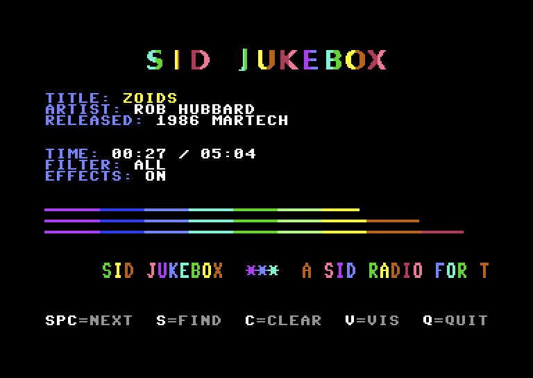

# SID Jukebox for the C64 Ultimate

[🇫🇷 Français](README.fr.md) · 🇬🇧 English

An online jukebox in the spirit of *Belote LAN C64*: the **C64 Ultimate** asks a server for a random SID tune,
receives it through the Ultimate's network interface (UCI/TCP) and **plays it itself** (the 6510 runs the
tune's own code, just like back in the day). No synchronisation between clients: everybody gets their own draw.

The play screen: giant logo, title / artist / year, elapsed time, three VU meters (one per SID voice) in a
rainbow gradient, a demo-style scroller whose text comes from the server, and the key legend.



*The play screen, captured in the VICE emulator (demo build): rainbow title, VU meters, server-driven scroller, version in the corner.*

```
 ┌────────────┐   text, TCP :6474     ┌──────────────────────┐
 │  server    │ ◄───────────────────► │  C64 Ultimate        │
 │ server.py  │   RANDOM [pattern]    │  c64/ (Oscar64 + 6502)  │
 │ jukebox.db │ ──► OK|…|raw code     │  UCI: TCP sockets    │
 └─────┬──────┘                       └──────────────────────┘
       │ indexer.py
 ┌─────┴──────┐
 │ HVSC (SID) │   ~61,000 files, lengths: Songlengths.md5
 └────────────┘
```

## Quick start

Requirements: Python 3 (`c64/chargen_set1.bin` only to regenerate the logo/scroller, see `dump_chargen.py`), `7z`, **Oscar64** (C compiler, `make OSC=/path/to/oscar64`) and **cc65** (`ca65`/`ld65`, for the player), a C64 Ultimate with
the REST API and the *Command Interface* enabled. VICE is optional (hardware-free tests).

```sh
# 1. the HVSC (download from https://hvsc.c64.org/), then index the playable tunes
python3 indexer.py /path/to/C64Music -o jukebox.db --max-addr 0xAEFF

# 2. the server (port 6474)
python3 server.py --root /path/to/C64Music

# 3. the C64 client: set SERVEUR_IP, SERVEUR_PORT and ULTIMATE in c64/Makefile (or on the command line)
cd c64
make SERVEUR_IP=boombass.net SERVEUR_PORT=6474 ULTIMATE=192.168.1.27 deploy
```

`--max-addr` must stay equal to `HISTART - 1` in the Makefile (and to `MEM_HAUT` in `main.c`, which follows `HISTART` by itself): it is the upper
limit for tunes, the client lives in the memory above it.

## Running the server online

```sh
python3 server.py --root /path/to/C64Music --port 6474      # listens on 0.0.0.0 by default
```

- Open the TCP port in the firewall (`firewall-cmd --add-port=6474/tcp --permanent`) and at your host.
- Without root, a `systemd --user` service works (`~/.config/systemd/user/jukebox.service`,
  `Restart=on-failure`); for it to survive logout and reboot, an administrator must run
  `sudo loginctl enable-linger <account>`.
- Updating the tune database after a new HVSC release: [docs/UPDATE_DB.md](docs/UPDATE_DB.md).
- Updating from GitHub: `git pull` in the server folder (a read-only deploy key if the repo is private),
  then restart the server.

## Scroller text

The text comes from the file **`scroll.txt`** next to `server.py` (option `--scroll`). It is re-read on every
request: edit it without restarting, and the new text shows up **with the next tune** (the C64 does not talk to
the server while playing).

- Alphabet: `A-Z 0-9 * . , ! ? - / ' :` (45 glyphs); lower case is upper-cased, accents are stripped, anything else
  becomes a space.
- At most 150 characters; the server adds 10 spaces before and after.
- Missing or empty file: the C64 shows its short built-in text.

## Keys

| Key | Effect |
|---|---|
| `SPACE` | next tune |
| `S` | search by artist or title (RETURN confirms, RUN/STOP cancels, empty RETURN = everything, i.e. clears the filter) |
| `L` | loop on/off: replays the same tune when it ends (the tune restarts when you toggle it; replayed from memory, no network) |
| `V` | VU meters on/off (takes effect on the next tune) |
| `Q` | quit (back to BASIC) |

## The protocol (text, one command per line)

```
RANDOM [pattern]  ->  OK|id|size|seconds|frames/s|subtune|load|init|play|title|author|year|scroller\n
                      + <size> bytes of raw code (PSID header stripped)
RANDOM2 <end> [pattern]  ->  same, <end> = last address the client leaves to tunes (HISTART - 1), 4 hex digits,
                      e.g. AEFF: only tunes ending at or below it are offered (client v1.5+)
GET <id>          ->  same, for a specific tune
STATS             ->  STATS|compatible|total
error             ->  ERR|message
```

Clients before v1.5 send plain `RANDOM`: the server then only offers tunes ending before `$A700`. A v1.5+ client talking to a server without `RANDOM2` (reply `ERR|commande inconnue`) falls back to plain `RANDOM`. The last field is the scroller text (see above). Debuggable with `nc`. The pattern is searched in artist or
title, case-insensitively.

## How it works

- **Sorting (`indexer.py`)**: reads each `.sid` header, finds the length through the file's MD5 in
  `Songlengths.md5`, and flags as `compatible` the tunes our player can run: PSID (not RSID), a single SID,
  frame-driven (not a CIA timer), play routine present, fits between `$0800` and `HISTART-1`, 16 KB at most.
  Rejections and their reason stay in the database.
- **Player (`c64/play.s`)**: one raster interrupt per frame calls the tune's routine. While playing, zero page
  belongs to the tune (saved before, restored after) and the keyboard is read straight from the matrix.
- **VU meters**: the SID registers are write-only. During the tune call, `$D000-$DFFF` is mapped to RAM; writes
  aimed at the SID land there, get copied to a buffer, then to the real chip. Each voice's ADSR envelope is
  simulated from that buffer.
- **Display**: play screen in VIC bank 3 (`$F400`, characters at `$F800`, RAM under the KERNAL), with a custom
  character set (thin VU bars, logo, scroller letters). The scroller uses hardware scrolling (`$D016`),
  confined to its two lines by two raster interrupts.
- **Memory map**: `$0800-(HISTART-1)` tune; `HISTART-$CFFF` client; `$F400-$FFFF` display.
  The client is almost full (7 spare bytes in BSS at v1.1): every new feature costs memory, hence the very
  short built-in scroller text and the in-place conversion of the server text in the header buffer.

## Ultimate pitfalls (learned the hard way)

- **Never redeploy / reset the C64 with an open socket**: the Ultimate's command interface can hang until
  power is cycled. The client keeps no socket open while playing; to redeploy, wait for the "déconnexion"
  line in the server log.
- After a network read error (-1), do not write to or close that socket any more.
- The C part is compiled with Oscar64 (plain ASCII literals, no conversion; the player is assembled apart with ca65).
  Oscar64 keeps its temporaries in zero page `$02-$63`, which the player saves and restores around the tune.
- RAM under the KERNAL cannot be read back by the CPU (it sees the ROM): anything you need to re-read lives
  in an ordinary buffer.
- Changing a VIC-II colour mid-line leaves a grey pixel: if you do it, do it in the border.

## Files

| | |
|---|---|
| `indexer.py` | indexes the HVSC into `jukebox.db` (SQLite) |
| `update_db.sh` | re-index + upload + restart + test, with safeguards ([docs](docs/UPDATE_DB.md)) |
| `server.py` | asyncio server: draw, search, sends the raw code and the scroller text |
| `scroll.txt` | scroller text, re-read on every tune |
| `client_pc.py` | PC test client; can also push a SID to the Ultimate through its REST API |
| `c64/client.c`, `main.c`, `uci.c`, `console.c` | client (Oscar64): network (UCI), interface, search; `console.c` writes straight to screen RAM |
| `c64/play.s` | PSID player, VU meters, scroller, logo |
| `c64/asm.cfg`, `build.sh` | linker map of the player and the two-pass build (the program is loaded at `$0801`, then a small copier in `client.c` moves it to `HISTART`) |
| `c64/make_logo.py`, `make_scroll.py` | generate `logo.s` and `scroll.s` (committed data; fixed 45-glyph alphabet) |
| `c64/dump_chargen.py` | extracts the character ROM from VICE for `make_scroll.py` |
| `c64/make_demo.py` | network-less demo build (`make demo`), for testing in VICE |

Updating the tune database: [docs/UPDATE_DB.md](docs/UPDATE_DB.md).
Project history (in French): [HISTORY.md](HISTORY.md).

## License and copyright

The code is released under the [MIT License](LICENSE). The HVSC tunes are copyrighted; any use beyond private listening is subject to copyright (see the HVSC's
`DOCUMENTS/Disclaimer.txt`). This repository contains no tunes and no C64 ROM; running a public server was
discussed with the HVSC team, who replied on 2026-11-19: "It's all ok for us, please go on with your project." This is
the team's approval, not a licence: the rights stay with the original composers.
